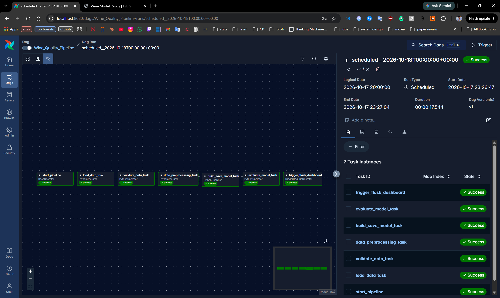
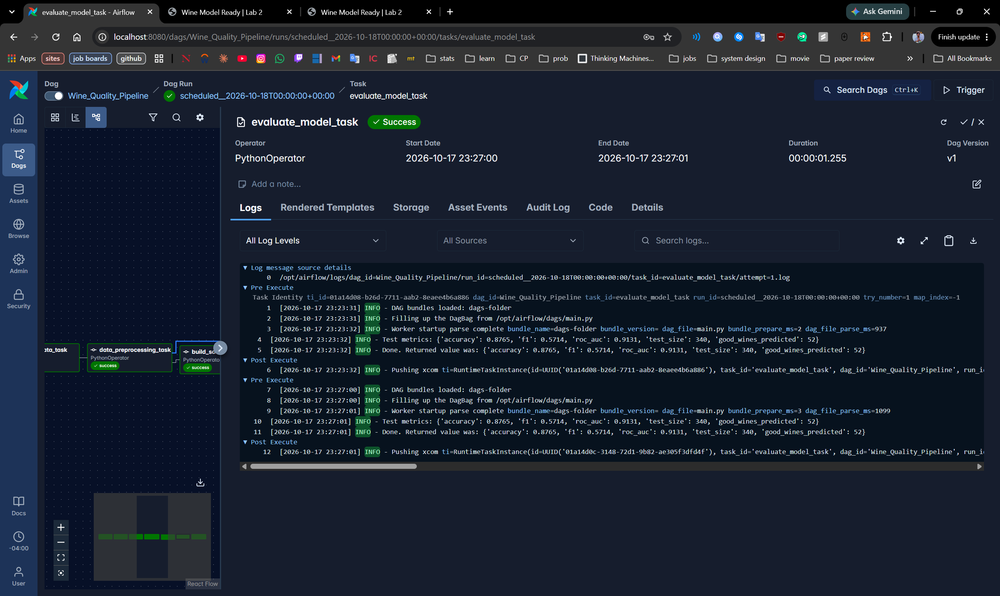
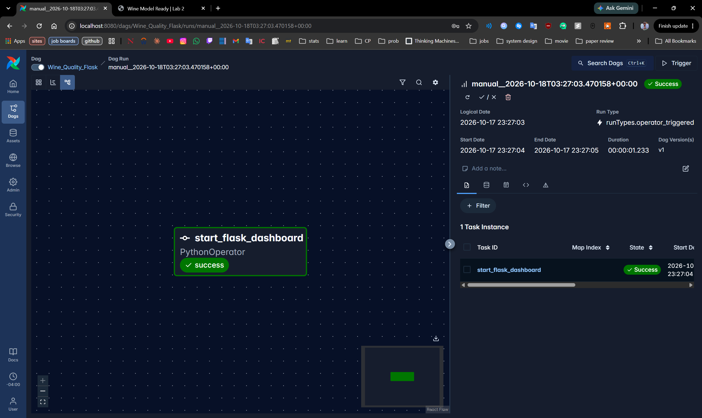
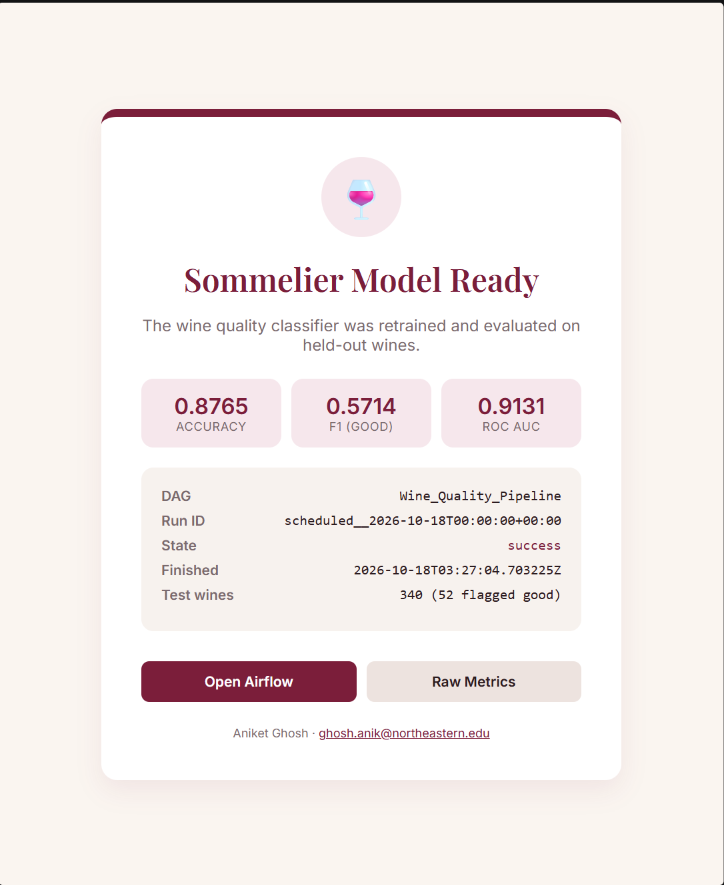

# Airflow Lab 2: Red Wine Quality Pipeline

**Author:** Aniket Ghosh (ghosh.anik@northeastern.edu)

## Problem Statement
A small winery wants a quick first check on new batches before they go to the tasting panel. Given 11 lab measurements of a red wine (acidity, residual sugar, sulphates, alcohol, etc.), can we predict whether tasters will rate it **good** (quality score of 7 or higher out of 10)?

Only about 13.5% of wines in the data are "good", so this is an imbalanced binary classification problem. The pipeline retrains the model weekly with Airflow and serves a small Flask page that shows whether the latest run worked and how the model scored.

## Dataset
[Wine Quality (red)](https://archive.ics.uci.edu/dataset/186/wine+quality) from the UCI Machine Learning Repository (Cortez et al., 2009). 1,599 Portuguese "Vinho Verde" red wines, semicolon separated, stored at `dags/data/winequality-red.csv`.

| Column | Description |
|---|---|
| fixed acidity ... alcohol | 11 physicochemical measurements |
| quality | Median taster score (0-10), turned into the target `quality >= 7` |

## What changed from the original lab
- New dataset and problem (wine quality instead of ad clicks)
- Added a `validate_data` step that checks for nulls and bad scores and drops duplicate rows (240 of them)
- Stratified split and a single `StandardScaler` instead of stacking two scalers
- `RandomForestClassifier` with `class_weight="balanced"` instead of logistic regression
- `evaluate_model` reports accuracy, F1 and ROC AUC, saves `metrics.json` and pushes the metrics to XCom
- Flask page shows the metrics, has a `/metrics` JSON endpoint, and shows the status note on the failure page
- Flask app gets a JWT from `/auth/token` before calling the API (Airflow 3 rejects basic auth with a 401), and skips starting a second server if one is already on port 5555
- DAGs renamed, scheduled weekly, owner set to me, wine-colored templates

## Prerequisites
- Docker Desktop with Docker Compose
- The Airflow 3 `docker-compose.yaml` in this folder (same one used in Lab 1)
- Basic understanding of Airflow DAGs and operators

## Running it
```bash
./setup.sh
docker compose up -d
```
1. Open Airflow at http://localhost:8080 (user `airflow`, password `airflow`).
2. Unpause `Wine_Quality_Pipeline`. Unpausing starts the latest scheduled run on its own, so a manual trigger isn't needed.
3. When it finishes it triggers `Wine_Quality_Flask`, which starts the status page on port 5555. Make sure the worker exposes `5555:5555` in the compose file, then open http://localhost:5555.

## Airflow Email Configuration (optional)
The `send_email` task in `main.py` is commented out because it needs SMTP set up.

1. Create a Gmail app password: [instructions](https://support.google.com/accounts/answer/185833)
2. In `config/airflow.cfg`, under `[smtp]`, set:
   - smtp_host = smtp.gmail.com
   - smtp_starttls = True
   - smtp_ssl = False
   - smtp_user = YOUREMAIL@gmail.com
   - smtp_password = the app password from step 1
   - smtp_port = 587
   - smtp_mail_from = YOUREMAIL@gmail.com
   - smtp_timeout = 30
   - smtp_retry_limit = 5
3. Uncomment `send_email` in `main.py` and add it after `evaluate_model_task` in the dependency chain. It emails the metrics to ghosh.anik@northeastern.edu.

## DAG Structure

### `Wine_Quality_Pipeline` (dags/main.py)
```
start_pipeline >> load_data_task >> validate_data_task >> data_preprocessing_task
    >> build_save_model_task >> evaluate_model_task >> trigger_flask_dashboard
```

| Task | What it does |
|---|---|
| `start_pipeline` | BashOperator that echoes the run date |
| `load_data_task` | Reads the CSV, cleans column names, pickles the dataframe |
| `validate_data_task` | Fails if there are nulls or scores outside 0-10, drops duplicates |
| `data_preprocessing_task` | Builds the binary target, 75/25 stratified split, scales features |
| `build_save_model_task` | Trains a 200-tree random forest and saves `wine_rf.sav` |
| `evaluate_model_task` | Scores the model on the test set, writes `metrics.json`, returns metrics to XCom |
| `trigger_flask_dashboard` | Triggers `Wine_Quality_Flask` with `ALL_DONE`, so the page comes up even if training fails |

Each task passes the path of its pickle file to the next one through XCom (`task.output`).

`default_args` set the owner to Aniket Ghosh, one retry after a minute, and a start date of 2025-01-01. The DAG runs `@weekly` with `catchup=False`.

### `Wine_Quality_Flask` (dags/Flask_API.py)
Not scheduled; only runs when the pipeline triggers it.

| Piece | What it does |
|---|---|
| `get_latest_run_info()` | Calls the Airflow REST API (`/api/v2/dags/Wine_Quality_Pipeline/dagRuns`) for the latest run |
| `/` | Redirects to `/success` or `/failure` based on that run's state |
| `/success` | Shows run info plus accuracy, F1 and ROC AUC from `metrics.json` |
| `/failure` | Shows the state and a note (for example, still running or API error) |
| `/metrics` | Raw metrics as JSON |
| `/health` | Returns `ok` |
| `start_flask_dashboard` | PythonOperator that runs the Flask app on port 5555 |

## Results
From a local run of the same code (random_state = 7, 340 test wines):

| Metric | Score |
|---|---|
| Accuracy | 0.877 |
| F1 (good class) | 0.571 |
| ROC AUC | 0.913 |

Accuracy looks high partly because most wines are not good; F1 on the good class and ROC AUC are the more useful numbers here.

### Screenshots
Pipeline run, all 7 tasks green:



`evaluate_model_task` log with the test metrics:



`Wine_Quality_Flask` triggered by the pipeline:



Dashboard at http://localhost:5555:



## Conclusion
The pipeline takes raw lab measurements through validation, preprocessing, training and evaluation as separate Airflow tasks, then brings up a Flask page reporting the result. Splitting the steps makes failures easy to spot in the Airflow UI (a bad dataset fails at `validate_data_task`, not halfway through training), and the weekly schedule means a new batch of wine data only needs to replace the CSV.
