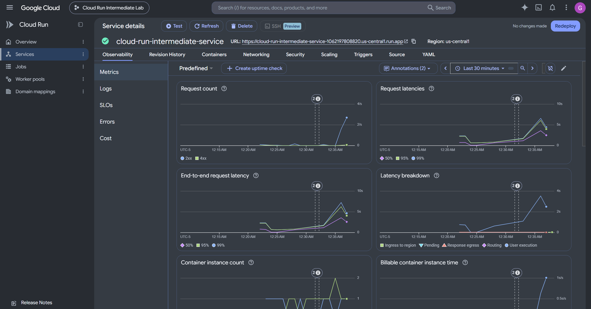
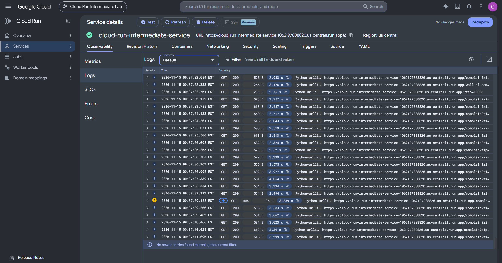

# Cloud Run Intermediate Lab: NYC 311 Complaint Department

Give it a New York ZIP code and it tells you what that neighborhood complains about most, plus its pettiest complaints.

The app is a Flask service on Cloud Run. It queries BigQuery's public `new_york_311` dataset (27 million complaints New Yorkers filed with the city through 311 between 2010 and 2021). It picks out the ZIP's #1 complaint and its pettiest complaints, like reporting an animal in a park or calling the city to compliment a taxi driver. `/wall-of-complaints` saves the result to Cloud Storage.

## Changes from the original lab

| Original | This version |
|----------|--------------|
| `/query` returns the top 10 baby names in Texas | `/complain?zip=X` sums up a ZIP's 311 complaints |
| `/upload` writes a dummy `hello.txt` | `/wall-of-complaints?zip=X` saves the result as `complaints/<zip>.json` in the bucket |
| Query is hardcoded | ZIP is checked (5 digits) and passed as a BigQuery query parameter, so it can't be used for SQL injection |
| Service account gets project-wide Storage Admin | Gets object access on one bucket plus BigQuery Job User, which is all the app needs |
| Builds locally with Docker and pushes to `gcr.io` | `gcloud run deploy --source` builds in Cloud Build and stores the image in Artifact Registry. Container Registry has been shut down. |

## Endpoints

| Route | Does |
|-------|------|
| `/` | Welcome message |
| `/complain?zip=10001` | Total complaints, the #1 complaint with a verdict, and up to 5 petty complaints with quips |
| `/wall-of-complaints?zip=10001` | Same result, also saved to `gs://<bucket>/complaints/10001.json` |

A ZIP that isn't 5 digits returns 400. A ZIP with no complaints returns 404 ("Either it's paradise or it's not in NYC").

## How the verdict is picked

| #1 complaint contains | Verdict |
|-----------------------|---------|
| `Noise` | "The official sound of 10001 is someone yelling 'keep it down'." |
| `HEAT` | "Landlords consider heat a premium feature." |
| `Parking` / `Driveway` | "Parking is a contact sport." |
| `Rodent` | "The rats are rent-stabilized." |
| anything else | "Mostly complains about '...'. Very on brand." |

The petty list is 17 hand-picked complaint types, each with a one-liner (see `PETTY` in [app.py](cloud-run-intermediate-app/app.py)).

## Deploy

```bash
PROJECT_ID=cloud-run-int-lab-79817
REGION=us-central1
BUCKET=$PROJECT_ID-wall-of-complaints
SA=complaint-bot@$PROJECT_ID.iam.gserviceaccount.com

gcloud projects create $PROJECT_ID
gcloud billing projects link $PROJECT_ID --billing-account=<BILLING_ACCOUNT_ID>
gcloud config set project $PROJECT_ID

gcloud services enable run.googleapis.com cloudbuild.googleapis.com artifactregistry.googleapis.com \
  storage.googleapis.com bigquery.googleapis.com iam.googleapis.com

gcloud storage buckets create gs://$BUCKET --location=$REGION --uniform-bucket-level-access
gcloud iam service-accounts create complaint-bot
gcloud storage buckets add-iam-policy-binding gs://$BUCKET --member=serviceAccount:$SA --role=roles/storage.objectAdmin
gcloud projects add-iam-policy-binding $PROJECT_ID --member=serviceAccount:$SA --role=roles/bigquery.jobUser

cd cloud-run-intermediate-app
gcloud run deploy cloud-run-intermediate-service --source . --region $REGION \
  --allow-unauthenticated --service-account $SA --set-env-vars BUCKET_NAME=$BUCKET
```

Each request scans about 1.2 GB in BigQuery, which is under a cent. The first 1 TB each month is free.

## Test

```bash
URL=$(gcloud run services describe cloud-run-intermediate-service --region $REGION --format "value(status.url)")
curl "$URL/complain?zip=10001"
curl "$URL/wall-of-complaints?zip=10001"
gcloud storage cat gs://$BUCKET/complaints/10001.json
```

### Results from the deployed service

Midtown Manhattan (10001):
```json
{
  "zip": "10001",
  "total_complaints": 120435,
  "number_one_complaint": "Noise (11,155 times)",
  "verdict": "The official sound of 10001 is someone yelling 'keep it down'.",
  "pettiest": [
    "1,459 x Noise - Helicopter: Officially yelling at the sky.",
    "189 x Illegal Fireworks: Every night is the Fourth of July.",
    "101 x Drinking: Hydrating, but make it illegal.",
    "98 x Urinating in Public: The whole city is the bathroom.",
    "48 x Animal in a Park: An animal. In a park. Send help."
  ]
}
```

Staten Island (10314):
```json
{
  "zip": "10314",
  "total_complaints": 213953,
  "number_one_complaint": "Street Condition (22,839 times)",
  "verdict": "10314 mostly complains about 'Street Condition'. Very on brand.",
  "pettiest": [
    "666 x Illegal Fireworks: Every night is the Fourth of July.",
    "447 x Drinking: Hydrating, but make it illegal.",
    "263 x Animal in a Park: An animal. In a park. Send help.",
    "176 x Unleashed Dog: The dog was living its best life.",
    "121 x Poison Ivy: Nature fought back."
  ]
}
```

Bad input, and a ZIP outside NYC:
```
$ curl "$URL/complain?zip=1000a"
{"error":"Give me a 5-digit NYC ZIP code. Example: /complain?zip=10001"}        (400)

$ curl "$URL/complain?zip=90210"
{"error":"No complaints from 90210. Either it's paradise or it's not in NYC."}  (404)
```

Saving to the bucket:
```
$ curl "$URL/wall-of-complaints?zip=11211"
{"message":"11211 is now on the Wall of Complaints.","posted_to":"gs://cloud-run-int-lab-79817-wall-of-complaints/complaints/11211.json"}
```

## Monitor

[traffic.py](traffic.py) sends 300 requests (10 at a time) with a mix of good ZIPs, bad ZIPs and saves, so the console graphs have something to show:

```bash
python traffic.py $URL        # or: python traffic.py $URL 500
```

Then open Cloud Run > `cloud-run-intermediate-service`:
- **Logs:** every request, including the 400s and 404s.
- **Metrics:** request count, latency, container instances, CPU and memory. Graphs take 1–2 minutes to catch up.

After one run of `traffic.py`, request count jumps to about 3/s (mostly 2xx, with a few 4xx from the bad ZIPs), and Cloud Run scales to 2 instances:



Each request shows up in the logs with its status, size and latency (about 3s, mostly BigQuery). The 404 is the ZIP outside NYC:



## Clean up

```bash
gcloud run services delete cloud-run-intermediate-service --region $REGION
gcloud storage rm -r gs://$BUCKET
gcloud artifacts repositories delete cloud-run-source-deploy --location $REGION
gcloud iam service-accounts delete $SA
```

Or delete the whole project: `gcloud projects delete $PROJECT_ID`
